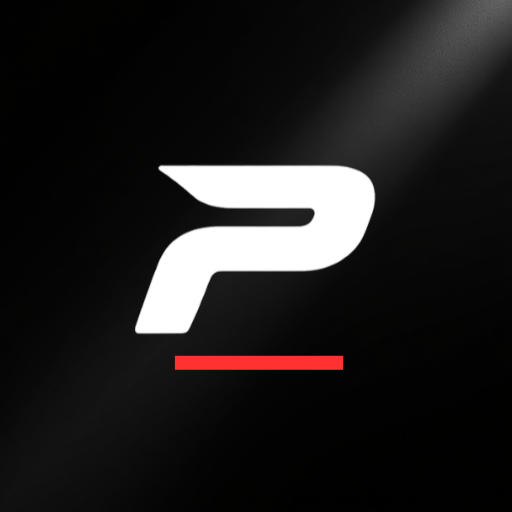

# PylaAndroid

PylaAndroid is an on-device PylaAI port for Android — no root and no ADB required.

Every PylaAI file such as `play.py` or `trophy_observer.py` is fully rewritten in Kotlin as `Play.kt`, `TrophyObserver.kt` and the others.

# Development status

**STABLE.** This is not a finished product and it is **not a guarantee of unattended gameplay** on any phone. Expect bugs, and always supervise the app while it runs. However, most bugs got fixed right now, **it is** reliable to let it go, always report bugs.

# How to use
Follow these steps to start using **PylaAI** on your Android device.

### 1. Install the App
- Download a build from the **Releases** page when one is published, or
- Build the APK yourself from the source code.

### 2. Grant Accessibility Permission
1. Open **PylaAndroid**.
2. Tap **Enable Accessibility Service**.
3. Tap **Installed apps**
4. If the permission is blocked by Android, go to:

```
Settings → Apps → PylaAndroid → ⋮ (Top-right menu) → Allow Restricted Settings
```

4. Return to **Settings → Accessibility** and enable the **PylaAI Accessibility Service**.


**Game MUST be in English!**


### 3. Grant Screen Capture (MediaProjection) Permission
1. Press **Start Bot**. (If you like it next to the start button there is an **overlay button** where you can activate a floating overlay to control the bot)
2. Android will display a **Screen Capture** permission dialog.
3. Tap **Start Now** (or **Allow**, depending on your Android version).
4. If prompted, choose **Entire Screen**.

> **Note:** This permission is required for the bot to analyze the screen. No screenshots or recordings are stored or uploaded.

### 4. Enjoy external auto-farming
Once pressed **Start Bot**:

- **Brawl Stars** will launch automatically.
- **Enjoy!**

# Playstyle builder

The optional [playstyle builder](tools/playstyle-builder/) generates a custom `.pyla` playstyle in
your browser. Open `tools/playstyle-builder/index.html`, pick a preset, tune it and download the
file — no server, account or upload involved. Import it in PylaAndroid via **Playstyles → Import
custom .pyla**, then select the playstyle and check the logs after starting. The builder only
creates the script; detections, brawler data and native input gates stay authoritative, and import
success is not proof of gameplay behaviour. See the
[builder README](tools/playstyle-builder/README.md) for limits and the included checks.<

**Too lazy for playstyle builder and wanna use AI? Take a look at the [AGENTS.md](tools/playstyle-builder/AGENTS.md)**

# Supported devices

Since `v4.1.0` the app adapts to the screen layout and measures the device before a match instead of assuming one reference phone.

| Layout | Status |
| --- | --- |
| 16:9 | Run on a cloud Android 13 instance (720p, slow CPU). |
| About 19.5:9 to 20:9 | Run on a Galaxy S26 Ultra and on the cloud instance. |
| 4:3 (tablets, unfolded foldables) | Run on the cloud instance only; no real tablet has been tested yet. |

- The game language must be **English**.
- APKs contain `arm64-v8a` and `x86_64` libraries only.
- On slow devices a loop takes roughly 0.7–1.1 s; the bot reacts late there.
- If it does not work on your device, export the diagnostic log from the app (**Save log** or **Share log**) and attach the file to a bug report. Reports contain the device model, screen and capture size, which is what we need to fix it. See [docs/KNOWN_ISSUES.md](docs/KNOWN_ISSUES.md) for the current limits.

# Can I use on Emulator?
Yes! You can use **PylaAndroid's APK** also directly on your android **emulator**!

# Diagnostics

PylaAndroid can export a diagnostic report to help diagnose problems. The app has no network access and uploads nothing: the report is a text file that you save or share yourself. Reports are redacted and are intended to exclude screenshots, raw OCR text and credentials — this is the design intent, not a promise that a report can never contain anything sensitive. Full details live in [docs/DIAGNOSTICS.md](docs/DIAGNOSTICS.md).

> The report is plain text. Review the file before posting it publicly.

# Credits
**Developers of original project:**
- AngelFire
- iyordanov

## License

The project is distributed under the **ANCS-1.0** license — see [LICENSE](LICENSE).
